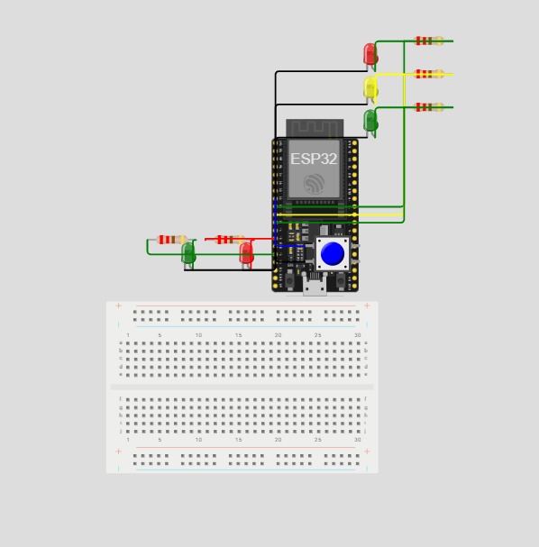

# ESP32 FreeRTOS Traffic Light System

## Overview
A FreeRTOS-based traffic light and pedestrian crossing controller using an ESP32, OLED display, LEDs, and a push button.

## Features
- Traffic light control (Green → Yellow → Red)
- Pedestrian WALK / STOP signals
- OLED status display
- Button-triggered crossing requests
- FreeRTOS tasks, queues, and mutexes

## FreeRTOS Components
- **Pedestrian Task**: Detects button presses
- **Traffic Task**: Controls signal states
- **Display Task**: Monitors display status
- **Logger Task**: Outputs system logs

### RTOS Features Used
- `xTaskCreate()`
- `xQueueSend()` / `xQueueReceive()`
- `xSemaphoreCreateMutex()`
- `vTaskDelay()`

## Hardware
- ESP32
- SSD1306 OLED Display
- Push Button
- 5 LEDs (Red, Yellow, Green, WALK, STOP)
- Breadboard & Resistors

## Traffic Sequence
1. Cars Green, Pedestrians STOP
2. Button Pressed
3. Cars Yellow (3s)
4. Cars Red, Pedestrians WALK (7s)
5. Pedestrians STOP (2s)
6. Return to Green

## Purpose
Demonstrates real-world FreeRTOS concepts including multitasking, inter-task communication, synchronization, and embedded system design on ESP32.
